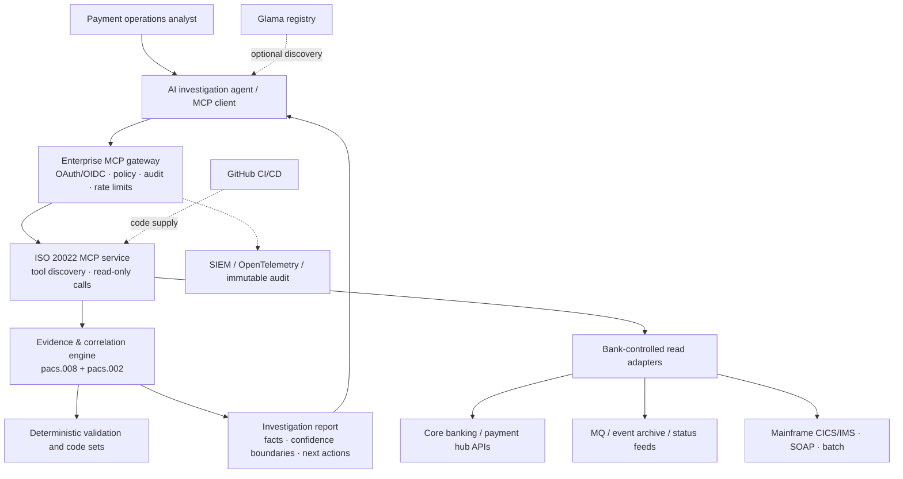
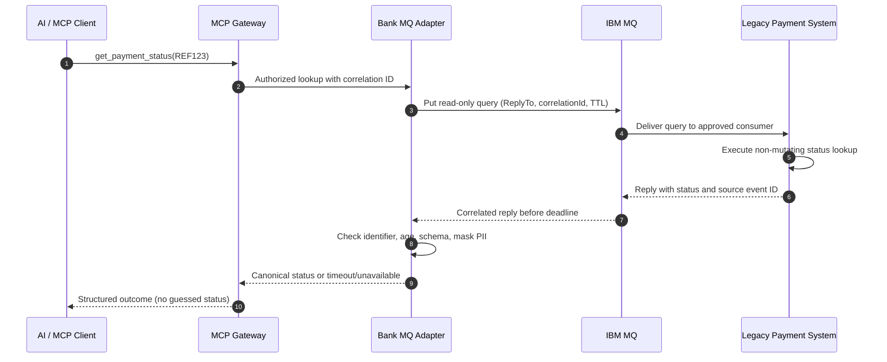

# ISO 20022 Payment Investigation MCP — Solution Architecture & Legacy Integration

**Architecture baseline:** 12 November 2026  
**Repository:** https://github.com/Muthukumar123/iso20022-payment-evidence-investigation-mcp  
**Implementation:** PR #1 hardening; PR #2 evidence-based investigation (stacked; pending review/merge).  
**Classification:** Reference solution and synthetic proof of concept; not a production banking installation.

## 1. Executive position

The differentiated product is **evidence-led payment exception investigation**, not XML parsing wrapped in MCP. A conventional ISO 20022 REST endpoint is appropriate for a predetermined `parse/validate` workflow. MCP adds value when an authorized AI client needs to *discover and orchestrate multiple read-only capabilities*—payment records, status reports, scheme rules, historical events, and diagnostic evidence. The system must never equate a language-model interpretation with an authoritative payment decision.

**Design thesis:** AI asks *which evidence is needed*; deterministic services answer *what the records actually say*. The bank remains the system of record and the only authority for payment mutation.

## 2. Scope and implementation boundary

| Capability | Status | Evidence or dependency |
|---|---|---|
| pacs.008 / pacs.002 parsing, business checks, code lookup | Implemented | Existing Python modules |
| Namespace/version boundaries, bounded XML, optional local XSD | Implemented on PR #1 | Requires bank-approved official schemas for authoritative XSD results |
| Structured MCP responses and stdio transport | Implemented on PR #1 | Does not constitute remote gateway deployment |
| Read-only integration interface with authorization hook | Implemented on PR #1 | No concrete bank system connected |
| Correlate supplied pacs.008 and pacs.002; provenance and safe findings | Implemented on PR #2 | No live payment retrieval or account status confirmation |
| Multi-system payment-history retrieval, enterprise gateway, human-approval workflow | Proposed | Requires bank APIs, IAM, event infrastructure and governance |
| CBPR+ / SEPA time-aware business rules and maintained external codes | Proposed | Requires licensed/approved scheme rules and reference-data lifecycle |
| Actual repair, payment amendment, resubmission, settlement | Out of scope | Bank-owned systems with separate approved controls |

## 3. Logical architecture



**Runtime rule:** Glama is a registry/hosting option, *not* a required intermediary and must not receive payment payloads merely because the tool is publicly listed. The current server uses **stdio**; the remote gateway shown above is a future deployment component.

## 4. Runtime sequence — evidence-backed investigation

```mermaid
sequenceDiagram
 autonumber
 actor Analyst
 participant Agent as AI Agent / MCP Client
 participant Gateway as Enterprise MCP Gateway (future)
 participant Adapter as Bank Read Adapter
 participant Hub as Payment Hub / Archive
 participant Engine as ISO 20022 Evidence Engine
 Analyst->>Agent: Why was REF123 rejected?
 Agent->>Gateway: Tool call: get_payment_evidence(REF123)
 Gateway->>Gateway: Authenticate, scope, policy, audit
 Gateway->>Adapter: Authorized read request
 Adapter->>Hub: Retrieve pacs.008 and pacs.002
 Hub-->>Adapter: Immutable source records + IDs
 Adapter-->>Agent: Redacted XML / authorized evidence refs
 Agent->>Engine: investigate_payment(pacs008_xml,pacs002_xml)
 Engine->>Engine: Exact group + transaction ID correlation
 Engine->>Engine: Code lookup; flag unknown; security evaluation
 Engine-->>Agent: Status, provenance, limitations, no-auto-retry decision
 Agent-->>Analyst: Evidence-backed explanation + manual next step
```

**Current/proposed split:** `investigate_payment` exists in PR #2 for *supplied* XML. `get_payment_evidence`, enterprise gateway and bank data access are proposed architecture, not existing tools.

## 5. Why this is more than a basic validator

A standard `validate_message(pacs008_xml)` can determine whether one message satisfies selected syntactic and business checks. It cannot establish that an external bank has rejected a transaction. A correlated `pacs.002` can provide evidence that the bank reported `RJCT` with a code such as `AC04`; it does **not** independently prove the real-world beneficiary account is closed.

The PR #2 engine deliberately:

1. Requires a matching `OrgnlMsgId` plus an exact transaction identifier; no name/amount fuzzy matching.
2. Cites original message fields and `TxSts` / `Rsn/Cd` in an evidence ledger.
3. Leaves unknown reason codes unknown rather than hallucinating meanings.
4. Distinguishes bank-reported facts from investigative hypotheses.
5. Preserves read-only behavior and recommendations requiring human authorization.
6. Surfaces injection risk and schema-validation limits separately.

### Synthetic proof, not production claim

`python -m evals.compare_investigation` compares a **single-pacs.008 validator** with the new two-message investigation function across four engineered fixtures: known rejection `AC04`, known rejection `AM05`, unknown reason `ZZ99`, and mismatch of the original message ID. The comparison is intentionally narrow: the first implementation never sees the status report, so it cannot correlate it. Treat results as a capability demonstration, **not** as measured intelligence or banking accuracy. A credible field benchmark needs expert-labeled incidents, held-out samples, misleading data, security adversaries, blinded scoring, and operator-reviewed outcomes.

## 6. Core banking and legacy connectivity patterns

| Integration pattern | Bank-side source | Adapter implementation | Best use | Cautions |
|---|---|---|---|---|
| REST / OpenAPI facade | Modern payment hub, core banking API | Gateway + scoped HTTPS client, optional mTLS | On-demand payment lookup | Throttling, fine-grained entitlement, PII minimizing |
| Mainframe API enablement | CICS, IMS, Db2, COBOL applications | Bank-owned z/OS Connect API provider → REST adapter | Existing z/OS business assets | Do not bypass CICS/IMS authorization or copybook mapping |
| MQ request/reply | IBM MQ request queues | Controlled request/reply service; correlation ID, TTL, reply queue | Systems without synchronous REST | Timeouts, duplicate reply, delivery semantics, no payment posting |
| Event-driven read model | Payment hub events, Kafka/MQ | Ingest service → canonical event store → read API | Historical correlation and high volume | Replay, ordering, event lag, retention, provenance |
| SOAP / ESB | Older payment middleware | Anti-corruption adapter SOAP→typed canonical JSON | Reuse existing enterprise services | XML/WS-Security validation and contract/version drift |
| Managed batch/file | Mainframe extract, SFTP/MFT, COBOL flat files | Controlled batch ingest → immutable archive + indexing | Legacy statement/status delivery | File completeness, reconciliation, processing delays |
| Read-only database view | Approved operational reporting replica | Bank-managed query service, not direct LLM DB access | Fast investigative history | Query policy, row-level security, stale data |

**Preferred order:** reuse existing *read-only payment hub API*; otherwise expose approved mainframe assets using z/OS Connect; if synchronous lookup is unavailable, build a governed event projection from MQ/Kafka; use batch only when latency permits. Keep MCP independent of these vendor protocols behind a canonical adapter contract.

### Bank adapter contract

An integration adapter should expose a normalized, bank-owned, read-only interface, for example:

```json
{
  "source_system": "PAYMENT_HUB_EU",
  "payment_reference": "REF123",
  "msg_id": "MSG-001",
  "end_to_end_id": "E2E-001",
  "uetr": "00000000-0000-4000-8000-000000000001",
  "message_family": "pacs.002",
  "message_version": "pacs.002.001.10",
  "observed_at": "2026-11-12T10:30:00Z",
  "source_event_id": "evt-001",
  "payload_reference": "bank-controlled-archive-key",
  "content_sha256": "computed-sha256-of-source-content",
  "classification": "restricted-payment-data"
}
```

The values above are illustrative. The actual content hash must be computed from the authoritative source bytes and is not an arbitrary text value. The agent should receive only the minimum necessary fields; raw payload access must be separately authorized.

## 7. Sequence — mainframe API facade

```mermaid
sequenceDiagram
 autonumber
 participant Agent as AI / MCP Client
 participant Gateway as MCP Gateway
 participant Adapter as Read-only Core Adapter
 participant API as Bank API Gateway / z/OS Connect
 participant CICS as CICS / IMS / Db2
 Agent->>Gateway: get_payment(REF123)
 Gateway->>Gateway: Verify delegated identity, scope, purpose
 Gateway->>Adapter: find_payment(REF123, principal)
 Adapter->>API: HTTPS GET /payments/REF123 (mTLS, token)
 API->>CICS: Map JSON to approved transaction/query
 CICS-->>API: Payment status and references
 API-->>Adapter: JSON + source timestamp
 Adapter->>Adapter: Normalize; mask; attach evidence ID
 Adapter-->>Gateway: Canonical read-only record
 Gateway-->>Agent: Authorized structured result
```

IBM documents z/OS Connect as a way to expose CICS, IMS, and Db2 assets as REST APIs; this is an integration *option*, not a claim about any particular bank's installation.

## 8. Sequence — asynchronous legacy MQ



**Guardrails:** Dedicated read-only queues and service identities, strict command allowlists, short TTLs, idempotent correlation and no shared production posting credentials. Absence of a reply is `unavailable`, not `accepted` or `rejected`.

## 9. Sequence — safe repair simulation (proposed)

```mermaid
sequenceDiagram
 autonumber
 actor Analyst
 participant Agent as AI Agent
 participant Policy as Authorization Policy
 participant Simulator as Deterministic Repair Simulator
 participant Rules as Scheme / XSD Rules
 participant Hub as Payment Hub
 Analyst->>Agent: Could a corrected beneficiary IBAN resolve this?
 Agent->>Policy: Check entitlement and simulation purpose
 Policy-->>Agent: Simulation only
 Agent->>Simulator: Preview changes against copied message
 Simulator->>Rules: Validate proposed data and rule version
 Rules-->>Simulator: Diagnostic differences
 Simulator-->>Agent: Before/after findings; uncertainties
 Agent-->>Analyst: Proposed correction, not executed
 Note over Agent,Hub: No mutation or resubmission in MCP path
 Analyst->>Hub: Separate bank-approved change process, if authorized
```

This simulation is a **future capability** and is not in the current repository.

## 10. Integration security and non-functional requirements

- **Authentication:** OAuth/OIDC or bank-issued workload identity at the gateway; delegated user claims and tool-scoped authorization; mTLS between integration tiers where required.
- **Authorization:** Read-only principle, purpose of use, payment/customer entitlement, segmentation by jurisdiction/tenant, deny-by-default and no MCP mutation tools.
- **Data minimization:** Pseudonymize or redact IBANs, names and remittance text before sending them to external AI services; minimize logs, prompts and traces.
- **Provenance:** Capture source system, event ID, processing timestamp, schema version, content digest and transformations; retain evidence under bank-managed access controls.
- **Resilience:** Timeouts and explicit partial results, idempotent query handling, MQ dead-letter management, circuit breakers, bulkheads, retry only on safe reads.
- **Observability:** Correlation ID from user request to gateway, adapter, messaging and source system; separate business/technical/security traces; avoid payment payloads in traces.
- **Rules:** Maintain scheme/market-practice profiles by effective date, currency precision, payment type and source; record which rules were used.
- **Quality:** Offline synthetic tests plus expert-labeled production-like cases with clear false-correlation, hallucination, unsafe-action and evidence-citation metrics.
- **Transport:** Current repo is stdio MCP. Remote Streamable HTTP must be engineered and tested against a pinned MCP protocol revision and matching client SDK, including current Origin validation, auth, and compatibility behaviors.

## 11. Proposed phased implementation

| Phase | Deliverables | Exit criteria |
|---|---|---|
| 0 — Deterministic core | XML hardening + explicit validation outcomes (PR #1) | CI passes; no silent unsupported message versions |
| 1 — Explainable investigation | Exact-message correlation, evidence ledger, read-only tool (PR #2) | Synthetic false-correlation/unknown-code tests pass |
| 2 — Bank adapter pilot | One approved read-only payment hub adapter; entitlement; audit | Authorized test environment and source record reconciliation |
| 3 — Legacy onboarding | z/OS Connect, MQ or file read-model adapter | Operational runbooks, resilience and data provenance validated |
| 4 — Time-aware rule intelligence | Scheme rule store + version pinning and specialist review | Bank SME sign-off and benchmark quality gates |
| 5 — Production governance | Private gateway, observability, data-loss controls, red teaming | Security/compliance approval and production readiness gates |

## 12. Deployment and Glama/GitHub roles

GitHub provides source, PR review, release tags, CI/CD and software supply-chain controls. Glama is useful for public MCP discovery and optionally hosting; it should remain outside restricted payment-data paths unless separately evaluated and approved. Current execution may be local stdio; production design should use a bank-operated private gateway where appropriate. **Neither GitHub nor Glama should be treated as the source of bank transaction truth.**

## 13. Review decisions required from the bank

1. Identify the authoritative payment hub/source of pacs.008/pacs.002 and a non-production read-only endpoint.
2. Approve the allowed payment identifiers and minimum fields for investigation.
3. Decide API vs MQ/event vs batch for each legacy system based on latency and ownership.
4. Specify the IAM principal, scopes, delegated user mapping and data residency policy.
5. Provide version-controlled official XSDs and applicable CBPR+/SEPA rule profiles.
6. Establish human escalation, remediation ownership, audit evidence retention, and production metrics.

## 14. References

- GitHub source: https://github.com/Muthukumar123/iso20022-payment-evidence-investigation-mcp
- Hardening PR #1: https://github.com/Muthukumar123/iso20022-payment-evidence-investigation-mcp/pull/1
- Evidence investigation PR #2: https://github.com/Muthukumar123/iso20022-payment-evidence-investigation-mcp/pull/2
- MCP Streamable HTTP specification (2026-07-28): https://github.com/modelcontextprotocol/modelcontextprotocol/blob/main/docs/specification/2026-07-28/basic/transports/streamable-http.mdx
- IBM z/OS Connect API providers: https://www.ibm.com/docs/en/zos-connect/3.0.0?topic=connect-what-are-zos-api-providers
- IBM z/OS Connect overview: https://www.ibm.com/docs/en/zos-connect/3.0.0?topic=overview-what-is-zos-connect

**Disclaimer:** Demonstration message IDs and transactions are synthetic. All production bank integration paths remain proposed until bank ownership, IAM, interface contracts, scheme rules and compliance controls are confirmed.